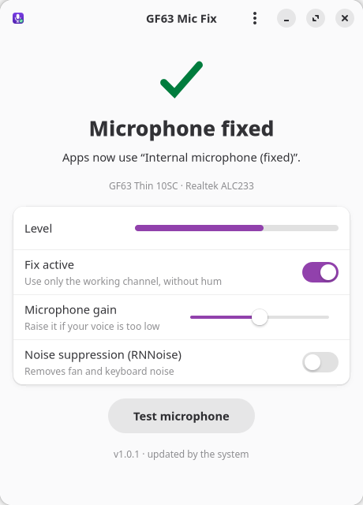
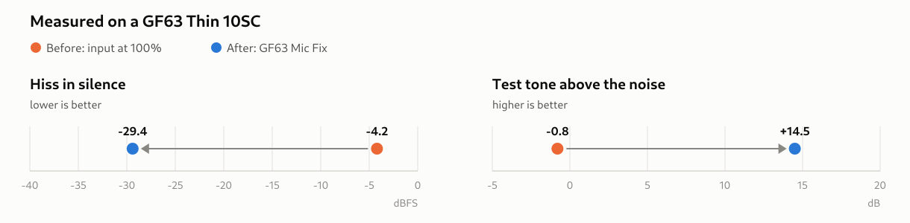
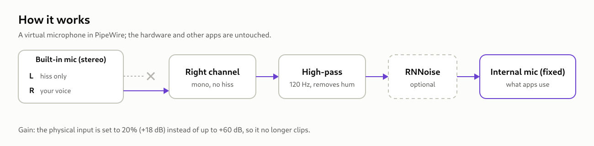

<p align="center"></p>

<p align="center"><b>English</b> · <a href="README.pt-BR.md">Português (Brasil)</a></p>

# GF63 Mic Fix

On Linux, the built-in microphone of the **MSI GF63 Thin** is unusable: whatever you say is buried
under loud hiss, on every distribution (Fedora, Nobara, Ubuntu, Mint, Zorin, Pop!_OS, Debian, Arch…),
while the same laptop works fine on Windows.

**GF63 Mic Fix** is a small app that fixes it with one switch, and undoes it just as easily.

<p align="center">
  <picture>
    <source media="(prefers-color-scheme: dark)" srcset="docs/assets/screenshot-en-dark.png">
    
  </picture>
</p>

<picture>
  <source media="(prefers-color-scheme: dark)" srcset="docs/assets/before-after-dark.png">
  
</picture>

## Why the microphone is noisy

Measured on a GF63 Thin 10SC (Realtek ALC233 codec, `10ec:0235`, subsystem `1462:12f4`):

1. **One channel is not a microphone.** There is a single digital mic, wired to the *right* channel.
   Linux records in stereo, and the *left* channel carries only hiss. A 1 kHz tone played on the
   speakers shows up on the right channel (+47 dB) and hardly at all on the left (+3 dB).
2. **The gain is far too high.** 100% input volume means +60 dB in the hardware (Capture +30 dB plus
   Internal Mic Boost +30 dB). With the usual defaults, the signal clips even in silence.
3. **Low hum** between 40 and 120 Hz on the good channel.

Windows' Realtek driver knows about this wiring; the generic Linux driver does not.

## Install

Pick your distribution. Every package is signed (see [Verifying downloads](#verifying-downloads)).

**Fedora, Nobara** (rpm; updates come through `dnf` and the Software app)

```sh
sudo dnf install https://github.com/junior9283/gf63-mic-fix/releases/download/v1.0.0/gf63-mic-fix-1.0.0-1.noarch.rpm
```

**Ubuntu, Linux Mint, Zorin OS, Pop!_OS, Debian** (deb; updates come through `apt` and the Update Manager)

```sh
wget https://github.com/junior9283/gf63-mic-fix/releases/download/v1.0.0/gf63-mic-fix_1.0.0-1_all.deb
sudo apt install ./gf63-mic-fix_1.0.0-1_all.deb
```

**Arch, Manjaro, EndeavourOS** (the app checks GitHub weekly and tells you when a new version is out)

```sh
sudo pacman -U https://github.com/junior9283/gf63-mic-fix/releases/download/v1.0.0/gf63-mic-fix-1.0.0-1-any.pkg.tar.zst
```

or build it yourself with the `PKGBUILD` attached to the [release](https://github.com/junior9283/gf63-mic-fix/releases/latest) (`makepkg -si`).

**Any other distribution** (installs for your user only, no root; updates itself)

```sh
curl -fsSL https://github.com/junior9283/gf63-mic-fix/releases/latest/download/install.sh | sh
```

Prefer to read it first? Download [`install.sh`](https://github.com/junior9283/gf63-mic-fix/releases/latest/download/install.sh),
look at it, then run `sh install.sh`. It checks the download against the project key when `gpg` is
installed, and tells you which packages are missing, if any.

The newest version is always on the [releases page](https://github.com/junior9283/gf63-mic-fix/releases/latest).

## Use

Open **GF63 Mic Fix** from the app menu.

- **Fix active**: turns the fix on or off. When it is on, apps get a new input called
  **“Internal microphone (fixed)”**, and it becomes the default.
- **Level**: a live meter, so you can see your voice (and no hiss) while the window is open.
- **Microphone gain**: raise it if people say your voice is too low.
- **Noise suppression (RNNoise)**: optional; removes fan and keyboard noise. It needs the package
  `noise-suppression-for-voice` (Fedora: `ladspa-noise-suppression-for-voice`).
- **Test microphone**: records 5 seconds and plays them back.

The fix starts by itself after every login. It changes nothing in the hardware, the kernel or the
system: it only adds a filtered microphone in PipeWire, for your user.

**Other GF63 Thin models.** The 10SC is verified. On other GF63 Thin variants, the app first runs a
short **diagnosis** (a 2-second beep through the speakers) to confirm the same defect before offering
the fix. If your model works, please [tell us](https://github.com/junior9283/gf63-mic-fix/issues/new?template=nova-variante.yml)
so it can be marked as verified.

The same actions exist on the command line: `gf63-mic-fix --status`, `--apply`, `--undo`.

## Updates

| Installed with | How it updates |
|---|---|
| rpm | the package adds this project's signed repository; `dnf upgrade` and the Software app pick up new versions |
| deb | the package adds this project's signed repository; `apt upgrade` and the Update Manager pick up new versions |
| Arch | a weekly check notifies you; update with the new package from the release page |
| install.sh | a weekly check downloads the new version, verifies its signature and installs it |

## Uninstall

Like on Windows: open **Uninstall GF63 Mic Fix** from the app menu (or *Menu → Uninstall…* in the
app). It first restores your previous microphone settings, then removes the program, asking for
your password when the package was installed system-wide.

If you remove the package with your package manager instead, run `gf63-mic-fix --undo` first.

## How it works

<picture>
  <source media="(prefers-color-scheme: dark)" srcset="docs/assets/how-it-works-dark.png">
  
</picture>

- A PipeWire **filter-chain**, run as a systemd *user* service (`gf63-mic-fix.service`), takes only
  the right channel (`FR`) of the built-in microphone, applies a 4th-order 120 Hz high-pass filter
  and, if you want, RNNoise.
- The physical input volume is set to 20% (+18 dB, no boost) instead of up to +60 dB.
- Your previous default input and volume are saved in `~/.config/gf63-mic-fix/` and restored by
  “Fix active” off, `--undo` and the uninstaller.

## Privacy

No telemetry and no accounts. The only network access is the update check: your package manager
for rpm/deb, or one request a week to `api.github.com` (Arch and install.sh). Audio never leaves
your computer; the level meter and the microphone test work locally and keep nothing.

## Verifying downloads

Every file of a release has a `.asc` signature, and `SHA256SUMS` lists their checksums. The project
key is [`data/signing-key.asc`](data/signing-key.asc), fingerprint:

```
5972 B2DC EFAF 53DC 842C  C3EA 2007 2D0D 235C AC26
```

```sh
gpg --import signing-key.asc
gpg --verify gf63-mic-fix-1.0.0.tar.gz.asc gf63-mic-fix-1.0.0.tar.gz
```

## Limitations

- Only the **MSI GF63 Thin** family (Realtek ALC233). Other laptops are left untouched.
- Needs **PipeWire 1.0 or newer** (the default on current distributions). PulseAudio-only systems are not supported.
- No Flatpak, Snap or AppImage: the fix needs a systemd user service and PipeWire access on the host,
  which sandboxed formats do not allow.

## Contributing

Bug reports, translations and reports about other GF63 variants are welcome.

```sh
git clone https://github.com/junior9283/gf63-mic-fix && cd gf63-mic-fix
python3 -m venv --system-site-packages .venv && .venv/bin/pip install pytest ruff
.venv/bin/pytest -q                     # unit tests, plus the window rendered off-screen
GF63_MIC_FIX_APPDIR=$PWD/src bin/gf63-mic-fix   # run from the source tree
packaging/build.sh 1.0.0 dist/          # rpm, deb, Arch package and install.sh tarball (needs nfpm)
```

Translations live in [`po/`](po/); run `scripts/update-po.sh` after changing texts.
Testing notes are in [`docs/testes/`](docs/testes/) (Portuguese).

## License

[GPL-3.0-or-later](LICENSE).
