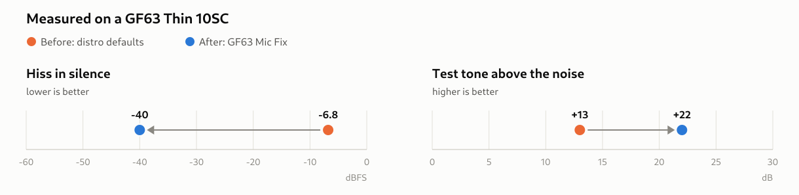
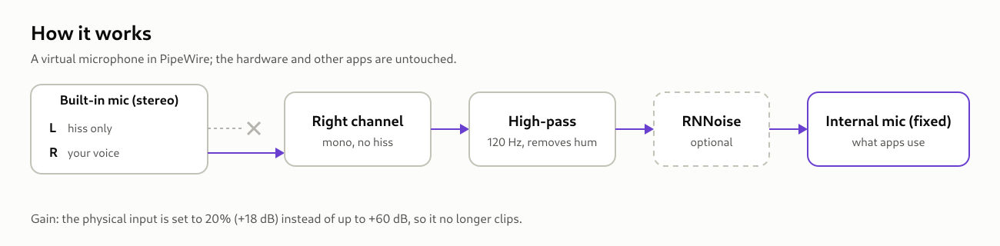

<p align="center"></p>

<p align="center"><a href="README.md">English</a> · <b>Português (Brasil)</b></p>

# GF63 Mic Fix

No Linux, o microfone embutido do **MSI GF63 Thin** é inutilizável: tudo o que você fala fica
enterrado num chiado alto, em qualquer distribuição (Fedora, Nobara, Ubuntu, Mint, Zorin, Pop!_OS,
Debian, Arch…), enquanto o mesmo notebook funciona bem no Windows.

O **GF63 Mic Fix** é um app pequeno que corrige isso com um botão, e desfaz com a mesma facilidade.

<p align="center">
  <picture>
    <source media="(prefers-color-scheme: dark)" srcset="docs/assets/screenshot-pt-BR-dark.png">
    
  </picture>
</p>

<picture>
  <source media="(prefers-color-scheme: dark)" srcset="docs/assets/before-after-dark.png">
  
</picture>

## Por que o microfone tem ruído

Medido num GF63 Thin 10SC (codec Realtek ALC233, `10ec:0235`, subsistema `1462:12f4`):

1. **Um dos canais não é microfone.** Existe um único microfone digital, ligado no canal *direito*.
   O Linux grava em estéreo, e o canal *esquerdo* só traz chiado. Um tom de 1 kHz tocado nos
   alto-falantes aparece no canal direito (+47 dB) e quase nada no esquerdo (+3 dB).
2. **O ganho é alto demais.** Volume de entrada em 100% significa +60 dB no hardware (Capture +30 dB
   e Internal Mic Boost +30 dB). Com os padrões comuns, o sinal satura até em silêncio.
3. **Ronco grave** entre 40 e 120 Hz no canal bom.

O driver da Realtek no Windows conhece essa ligação; o driver genérico do Linux, não.

## Instalação

Escolha a sua distribuição. Todos os pacotes são assinados (veja [Conferir os downloads](#conferir-os-downloads)).

**Fedora, Nobara** (rpm; as atualizações chegam pelo `dnf` e pela loja de apps)

```sh
sudo dnf install https://github.com/junior9283/gf63-mic-fix/releases/download/v1.0.0/gf63-mic-fix-1.0.0-1.noarch.rpm
```

**Ubuntu, Linux Mint, Zorin OS, Pop!_OS, Debian** (deb; as atualizações chegam pelo `apt` e pelo Gerenciador de Atualizações)

```sh
wget https://github.com/junior9283/gf63-mic-fix/releases/download/v1.0.0/gf63-mic-fix_1.0.0-1_all.deb
sudo apt install ./gf63-mic-fix_1.0.0-1_all.deb
```

**Arch, Manjaro, EndeavourOS** (o app consulta o GitHub toda semana e avisa quando sai versão nova)

```sh
sudo pacman -U https://github.com/junior9283/gf63-mic-fix/releases/download/v1.0.0/gf63-mic-fix-1.0.0-1-any.pkg.tar.zst
```

ou compile você mesmo com o `PKGBUILD` anexado à [versão](https://github.com/junior9283/gf63-mic-fix/releases/latest) (`makepkg -si`).

**Qualquer outra distribuição** (instala só para o seu usuário, sem root; atualiza sozinho)

```sh
curl -fsSL https://github.com/junior9283/gf63-mic-fix/releases/latest/download/install.sh | sh
```

Prefere ler antes? Baixe o [`install.sh`](https://github.com/junior9283/gf63-mic-fix/releases/latest/download/install.sh),
confira o conteúdo e rode `sh install.sh`. Ele confere o download com a chave do projeto quando o
`gpg` está instalado e diz quais pacotes faltam, se faltar algum.

A versão mais nova está sempre na [página de versões](https://github.com/junior9283/gf63-mic-fix/releases/latest).

## Uso

Abra o **GF63 Mic Fix** pelo menu de aplicativos.

- **Correção ativa**: liga ou desliga a correção. Ligada, os aplicativos ganham uma entrada nova
  chamada **“Microfone interno (corrigido)”**, que passa a ser a padrão.
- **Nível**: medidor ao vivo, para você ver a sua voz (e nenhum chiado) enquanto a janela está aberta.
- **Ganho do microfone**: aumente se disserem que a sua voz está baixa.
- **Supressão de ruído (RNNoise)**: opcional; tira o barulho da ventoinha e do teclado. Precisa do
  pacote `noise-suppression-for-voice` (no Fedora: `ladspa-noise-suppression-for-voice`).
- **Testar microfone**: grava 5 segundos e reproduz em seguida.

A correção volta sozinha a cada login. Ela não altera hardware, kernel nem arquivos do sistema: só
acrescenta um microfone filtrado no PipeWire, para o seu usuário.

**Outros modelos GF63 Thin.** O 10SC está verificado. Nas outras variantes do GF63 Thin, o app
primeiro roda um **diagnóstico** curto (um bipe de 2 segundos nos alto-falantes) para confirmar o
mesmo defeito antes de oferecer a correção. Se funcionar no seu modelo,
[conte para nós](https://github.com/junior9283/gf63-mic-fix/issues/new?template=nova-variante.yml)
para que ele passe a constar como verificado.

As mesmas ações existem na linha de comando: `gf63-mic-fix --status`, `--apply`, `--undo`.

## Atualizações

| Instalado com | Como atualiza |
|---|---|
| rpm | o pacote acrescenta o repositório assinado do projeto; o `dnf upgrade` e a loja de apps trazem as versões novas |
| deb | o pacote acrescenta o repositório assinado do projeto; o `apt upgrade` e o Gerenciador de Atualizações trazem as versões novas |
| Arch | uma consulta semanal avisa; atualize com o pacote novo da página de versões |
| install.sh | uma consulta semanal baixa a versão nova, confere a assinatura e instala |

## Desinstalação

Como no Windows: abra **Desinstalar GF63 Mic Fix** pelo menu de aplicativos (ou *Menu → Desinstalar…*
dentro do app). Ele primeiro restaura as configurações anteriores do microfone e depois remove o
programa, pedindo a sua senha quando a instalação foi feita no sistema.

Se preferir remover pelo gerenciador de pacotes, rode antes `gf63-mic-fix --undo`.

## Como funciona

<picture>
  <source media="(prefers-color-scheme: dark)" srcset="docs/assets/how-it-works-dark.png">
  
</picture>

- Um **filter-chain** do PipeWire, rodando como serviço systemd *do usuário* (`gf63-mic-fix.service`),
  usa só o canal direito (`FR`) do microfone embutido, aplica um passa-altas de 4ª ordem em 120 Hz e,
  se você quiser, o RNNoise.
- O volume da entrada física fica em 20% (+18 dB, sem boost), em vez de até +60 dB.
- A entrada padrão e o volume anteriores ficam salvos em `~/.config/gf63-mic-fix/` e são restaurados
  ao desligar a “Correção ativa”, pelo `--undo` e pelo desinstalador.

## Privacidade

Sem telemetria e sem contas. O único acesso à rede é a consulta de atualização: o seu gerenciador de
pacotes (rpm/deb) ou uma consulta por semana a `api.github.com` (Arch e install.sh). O áudio nunca sai
do seu computador; o medidor e o teste do microfone funcionam localmente e não guardam nada.

## Conferir os downloads

Cada arquivo de uma versão tem uma assinatura `.asc`, e o `SHA256SUMS` lista as somas de verificação.
A chave do projeto é [`data/signing-key.asc`](data/signing-key.asc), com a impressão digital:

```
5972 B2DC EFAF 53DC 842C  C3EA 2007 2D0D 235C AC26
```

```sh
gpg --import signing-key.asc
gpg --verify gf63-mic-fix-1.0.0.tar.gz.asc gf63-mic-fix-1.0.0.tar.gz
```

## Limitações

- Só a família **MSI GF63 Thin** (Realtek ALC233). Outros notebooks não são alterados.
- Precisa do **PipeWire 1.0 ou mais novo** (o padrão nas distribuições atuais). Sistemas só com PulseAudio não são suportados.
- Sem Flatpak, Snap ou AppImage: a correção precisa de um serviço systemd do usuário e de acesso ao
  PipeWire do sistema, o que os formatos isolados não permitem.

## Como contribuir

Relatos de problemas, traduções e relatos de outras variantes do GF63 são bem-vindos.

```sh
git clone https://github.com/junior9283/gf63-mic-fix && cd gf63-mic-fix
python3 -m venv --system-site-packages .venv && .venv/bin/pip install pytest ruff
.venv/bin/pytest -q                     # testes, incluindo a janela renderizada fora da tela
GF63_MIC_FIX_APPDIR=$PWD/src bin/gf63-mic-fix   # roda a partir do código-fonte
packaging/build.sh 1.0.0 dist/          # rpm, deb, pacote do Arch e tarball do install.sh (precisa do nfpm)
```

As traduções ficam em [`po/`](po/); rode `scripts/update-po.sh` depois de mudar textos.
As notas de teste estão em [`docs/testes/`](docs/testes/).

## Licença

[GPL-3.0-or-later](LICENSE).
